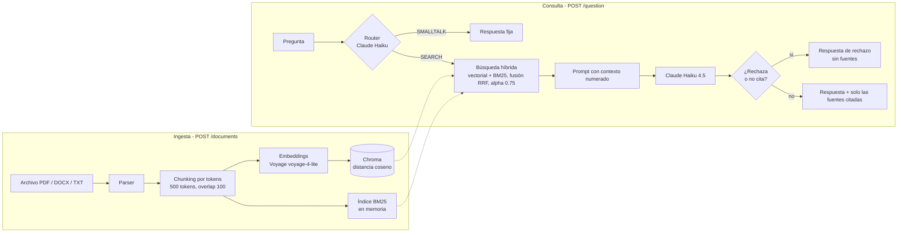

# RAG sobre documentos, sin frameworks

Sistema de preguntas y respuestas sobre documentos (PDF, DOCX, TXT) con **citas a las fuentes**. Pipeline completo escrito a mano: ingesta, chunking, embeddings, búsqueda híbrida, generación y evaluación.


## Qué hace

1. Subís un documento (`POST /documents`): se parsea, se divide en fragmentos y se indexa.
2. Hacés una pregunta en lenguaje natural (`POST /question`).
3. El sistema recupera los fragmentos más relevantes y Claude responde **solo con ese contexto**, citando los fragmentos usados con `[1]`, `[2]`, etc.
4. Si la respuesta no está en los documentos, responde que no la encuentra en vez de inventar.

## Arquitectura



**Capas:** `main.py` (HTTP) → `service/` (lógica: ingesta y consulta) → `repository/` (acceso a Chroma y BM25). Los servicios no conocen HTTP; el router traduce las excepciones de dominio a códigos de estado.

## Stack

Python 3.12 · FastAPI · Pydantic · Chroma · Voyage AI (embeddings) · Anthropic API (Claude Haiku 4.5) · rank-bm25 · tiktoken · pypdf · python-docx

> Las dependencias `langchain-*` de `requirements.txt` las trae el SDK de Voyage; el código de este repo no usa LangChain ni LlamaIndex.

## Decisiones de diseño

| Decisión | Elegí | Por qué |
|---|---|---|
| Frameworks | Ninguno (código propio) | Entender y poder depurar cada paso. Costo: más código. |
| Chunking | Tamaño fijo por tokens, 500 con overlap de 100 | Baseline simple y medible. Se mide en tokens porque es lo que cuenta el modelo (`tiktoken` es una aproximación). Probado también 250/50 (ver resultados). |
| Embeddings | Voyage `voyage-4-lite` | Anthropic no ofrece API de embeddings; Voyage es el proveedor que su documentación sugiere. |
| Vector store | Chroma local, distancia coseno declarada explícitamente | Simple para el PoC. Para el deploy está planeado pgvector (un solo motor de datos con Postgres). |
| Retrieval | Híbrido: vectorial + BM25, fusión **RRF** | La distancia coseno y el score de BM25 no son comparables; RRF usa solo la posición en cada ranking, sin normalizar. `alpha` pesa la rama vectorial (0.75). Pool de 20 candidatos por rama, se devuelven 4. |
| Router | Llamada corta a Claude Haiku (`SMALLTALK` / `SEARCH`) | Evita buscar y generar ante saludos. Las preguntas ajenas al tema van a búsqueda y se rechazan, para no contestar con el conocimiento del modelo. Costo: una llamada extra por consulta. |
| Generación | Prompt que restringe al contexto + validación en código | Si la respuesta empieza con la frase de rechazo, o no cita ningún fragmento, se devuelve el rechazo sin fuentes. Las fuentes devueltas son solo las citadas. No se depende de que el modelo obedezca el prompt. |
| Ingesta | Idempotente: borra por `source` y hace `upsert` | Re-subir un archivo lo reemplaza sin duplicar. Invalida el índice BM25. |
| Errores | Excepciones propias → 415 / 422 | Los errores del cliente se distinguen de los bugs, que salen como 500 y quedan en los logs. |

## Evaluación

**Dataset** (`evals/dataset.json`): 36 preguntas sobre el corpus, 25 con respuesta y 11 sin respuesta en los documentos (algunas ajenas al tema y otras del mismo tema). Cada pregunta con respuesta lleva una frase literal (`must_contain`) que tiene que aparecer en el fragmento recuperado; la comparación ignora tildes y mayúsculas. Corpus de prueba: 4 archivos (38 fragmentos con 500/100).

**Retrieval** (k = 4, `python3 -m evals.run_eval`):

| Configuración | recall@4 (500/100) | MRR (500/100) | recall@4 (250/50) | MRR (250/50) |
|---|---|---|---|---|
| semantic (solo vectorial) | 0.88 | 0.73 | 0.92 | 0.79 |
| hybrid, alpha 0 (solo BM25) | 0.80 | 0.76 | 0.80 | 0.70 |
| hybrid, alpha 0.25 | 0.88 | 0.76 | 0.80 | 0.73 |
| hybrid, alpha 0.5 | 0.92 | 0.81 | 0.84 | 0.72 |
| **hybrid, alpha 0.75** | **0.96** | **0.80** | 0.92 | 0.73 |
| hybrid, alpha 1 (equivale a semantic) | 0.88 | 0.73 | 0.92 | 0.79 |

Configuración elegida: **hybrid, alpha 0.75, chunks de 500/100**.

**Extremo a extremo** (`python3 -m evals.e2e_evals`, con la configuración elegida): 11/11 preguntas sin respuesta rechazadas correctamente, y 1/25 preguntas con respuesta rechazadas por error (la de "tabla histórica", cuyo único fragmento relevante no entra en el top 4). Mide si el sistema responde o rechaza, **no** si la respuesta es correcta. Una corrida completa cuesta unos US$0,10 de API.

### Hallazgos

- **El umbral de distancia no sirve en este corpus.** Los aciertos tienen distancia coseno entre 0.33 y 0.72; las preguntas sin respuesta, entre 0.35 y 0.84, y las del mismo tema caen dentro del rango de los aciertos. La distancia mide cercanía de tema, no si el fragmento contiene la respuesta. Por eso el rechazo se delega al prompt y a la regla de citas.
- **Híbrido ayudó con chunks de 500/100 y no con 250/50.** Con 250/50 la rama de palabras empeoró en todos los valores de alpha intermedios. No lo investigué; es una hipótesis pendiente.
- **Los chunks de 250/50 usan la mitad de contexto** (≈1000 contra ≈2000 tokens por consulta, estimado con 4 fragmentos), con un recall a una pregunta de distancia en semantic. Elegí calidad sobre costo con los números a la vista.

### Límites de la evaluación

Con 25 preguntas, una pregunta pesa 0.04 de recall: diferencias chicas son ruido. El alpha se eligió sobre las mismas preguntas con las que se mide, así que 0.96 es optimista. Las preguntas se escribieron mirando el texto, lo que favorece a la búsqueda por palabras. Falta un set de validación con preguntas parafraseadas.

## Cómo correrlo

```bash
python -m venv venv && source venv/bin/activate
pip install -r requirements.txt
```

Creá un `.env` con las claves:

```
ANTHROPIC_API_KEY=...
VOYAGE_API_KEY=...
```

```bash
uvicorn main:app --reload
```

Subir un documento y preguntar:

```bash
curl -X POST http://127.0.0.1:8000/documents \
  -F "file=@samples/banfield.txt;type=text/plain"

curl -X POST http://127.0.0.1:8000/question \
  -H "Content-Type: application/json" \
  -d '{"question": "¿Quién fundó el club?", "n_results": 4}'
```

Forma de la respuesta (ejemplo ilustrativo, texto recortado):

```json
{
  "answer": "Los dos máximos ídolos del club son Julio César Falcioni y Garrafa Sánchez [1].",
  "sources": [
    { "source": "banfield.txt", "chunk": 1, "text": "…Sus dos máximos ídolos son «el emperador», Julio César Falcioni…" }
  ]
}
```

Evaluaciones:

```bash
python3 -m evals.run_eval     # retrieval: recall@4 y MRR (semantic y hybrid, barrido de alpha)
python3 -m evals.e2e_evals    # extremo a extremo: llama a la API de Claude
```

`run_eval` mide lo que esté indexado en ese momento; si cambiás el tamaño de chunk, reindexá los documentos antes de correrlo.

## Estructura

```
main.py                  endpoints FastAPI
schema.py                modelos Pydantic de entrada y salida
service/ingest.py        parseo, chunking, ingesta
service/query.py         router, generación, citas
repository/repository.py Chroma, BM25, búsqueda híbrida (RRF)
exceptions/              excepciones de dominio
evals/                   dataset y scripts de evaluación
samples/                 documentos de ejemplo
```

## Limitaciones conocidas

- Corpus chico y de un solo tema; los resultados son orientativos.
- **Sin autenticación ni límite de consultas:** no exponer públicamente tal como está.
- El índice BM25 vive en memoria y se reconstruye después de cada ingesta; no escala a corpus grandes.
- La ingesta es síncrona (sin cola ni worker).
- Sin historial de conversación: cada pregunta es independiente ("¿y el estadio?" no funciona).
- Las citas no se verifican automáticamente (falta evaluar groundedness).
- El primer fragmento de un documento suele mezclar muchos temas y se recupera peor.


## Datos

Los textos de `samples/` provienen de Wikipedia en español (artículo sobre el Club Atlético Banfield), bajo licencia CC BY-SA 4.0.